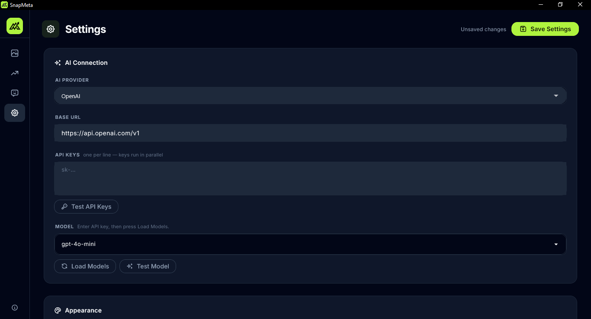
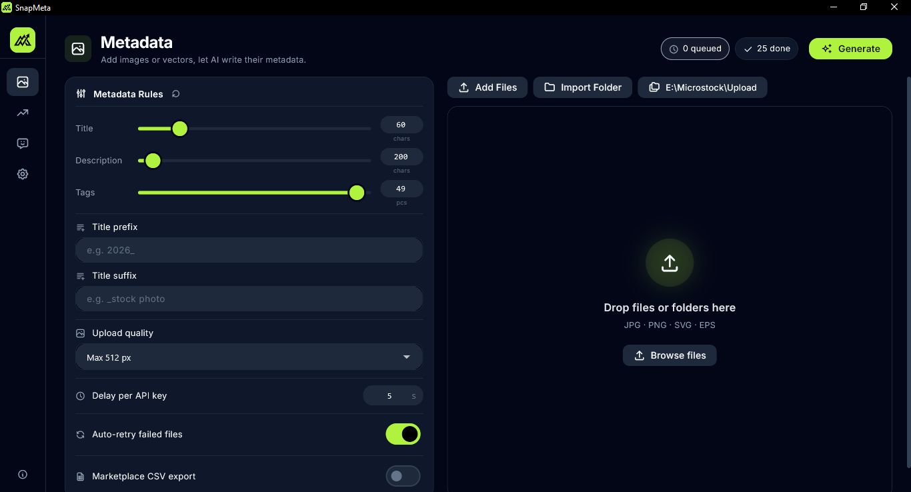
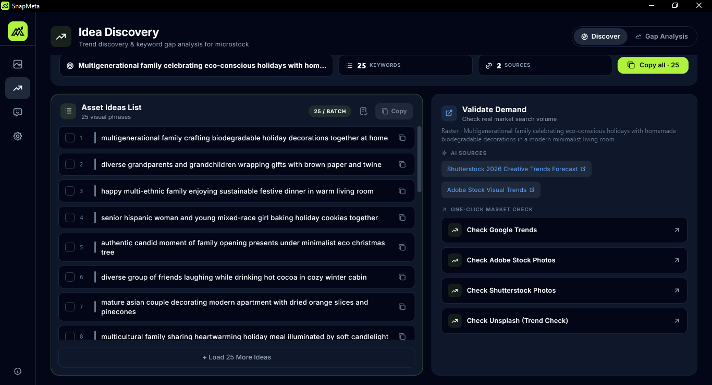
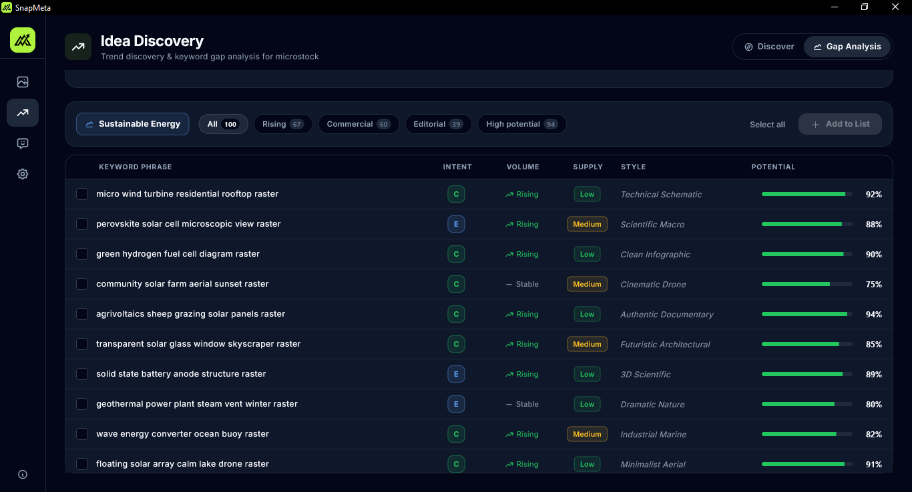
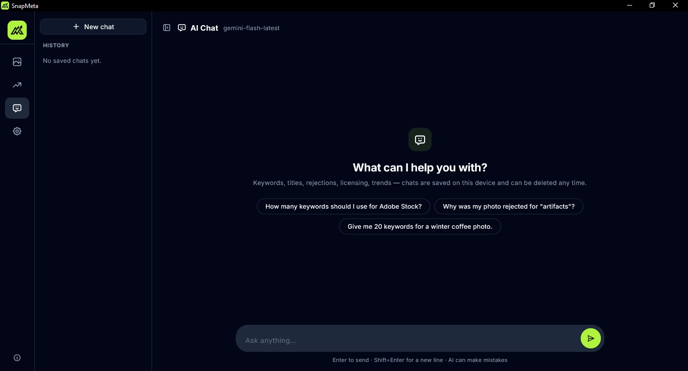

# SnapMeta

**AI Metadata Studio for Microstock**

Generate titles, descriptions, and keywords for your stock files in seconds — written directly into JPG, PNG, SVG, and EPS.

-0078D6)

---

## About

SnapMeta is a desktop application for microstock creators (Shutterstock, Adobe Stock, Getty iStock, and similar agencies). It uses AI vision to detect the content of your files, then auto-generates a title, a description, and long-tail keywords — all respecting the character limits and naming rules of each platform. Results are written directly into file metadata: XMP and EXIF for JPG, XMP for PNG and EPS, and native RDF metadata (`dc:title`, `dc:description`, `dc:subject`) for SVG.

**Now available on the [Microsoft Store](https://apps.microsoft.com/detail/9PD3B95ZG4DJ).**

---

## Features

### Metadata (free)

- **AI-powered generation** — Drop one file or an entire folder. SnapMeta analyzes each asset and generates a title, description, and dozens of long-tail keywords matching each platform's rules. No license and no daily limit: the only limit is your own AI provider quota.
- **Write directly into files** — Results are embedded into file metadata (XMP + EXIF for JPG, XMP and text chunks for PNG, an XMP packet for EPS, native `<dc:title>`/`<dc:description>` + RDF for SVG). No manual copy-paste.
- **Batch to an output folder** — Every result is saved as a new file named after the AI title (numbered automatically on collision). Your source files are never modified.
- **Marketplace CSV export** — One upload-ready CSV per marketplace (Adobe Stock and Shutterstock), saved to a `Metadata Export` folder inside your output. Includes per-platform column limits and validation warnings (filename length, category, keyword minimums).
- **Platform rules engine** — Presets for Shutterstock, Adobe Stock, and custom platforms. Configure max title length, max description length, max tags, title prefix/suffix, auto-retry, and inter-request delay.
- **Batch processing** — Process hundreds of files with progress bar, per-file logs (success/failed), and final summary.
- **Smart deduplication** — Detects duplicate metadata across files in the batch.
- **Auto-retry with fallback** — Failed generations automatically retry with alternate API keys.
- **Multiple API keys in parallel** — Add several keys per provider; SnapMeta distributes workload across them in parallel workers.
- **EPS support** — Ghostscript is bundled (AGPL-3.0) and auto-extracted on first EPS processing. Falls back to a silent online installer if the bundled runtime is unavailable. Runs offline once installed.
- **SVG rasterization** — SVG files are rendered to PNG for AI analysis without requiring an external tool.

### Ideas (requires a license)

- **Discover** — Scan trending niches for Footage, Raster, Vector, and PNG content. Get long-tail keyword lists, production notes, and AI-suggested sources.
- **Gap Analysis** — Find high-demand keywords with low supply. Filter by intent, trend volume, and potential, then push the best ones into your keyword list.

### Chat (requires a license)

- **SnapMeta assistant** — Ask about keywording, titles, description limits, rejection reasons and agency rules. Conversations are saved locally and survive restarts.

### Privacy & Security

- **Local-first** — Files are processed on your device. Only the selected file and your prompt are sent to the AI provider you configure; license activation additionally sends the license key and a device name to Lemon Squeezy.
- **Multi-provider support** — OpenAI, Google Gemini, Groq, OpenRouter, xAI Grok, Mistral, Moonshot Kimi, Alibaba Qwen, Ollama (local or cloud), or any OpenAI-compatible endpoint (`/chat/completions`).
- **API keys stored locally** — Never transmitted anywhere except to your chosen provider. Keys and chat history live in your Windows user profile, never inside the installed app or its installer.
- **No secrets in the build** — The release is scanned for provider keys and local preference/chat files before every release.
- **Consent gate** — First-run privacy dialog explains data flow; you must agree before using AI features.
- **Ghostscript for EPS** — Bundled (AGPL-3.0), auto-installed on first EPS processing. Runs offline.

### Licensing

- **One-time purchase** — Buy a SnapMeta license (USD $25.50) through Lemon Squeezy and activate it in **Settings → License**.
- The license key is stored locally and verified with Lemon Squeezy; a successful check is cached so the app keeps working offline for up to 14 days.
- **Metadata is free** — Generate titles, descriptions and tags for as many files as you want, with no license and no daily limit. You only need your own AI provider API key.
- **Ideas and Chat need a license** — Both pages stay locked behind a padlock overlay until a license is active. If a license is deactivated, refunded, or disabled, they lock again even if an API key is still saved. The saved key stays on this device for reactivation but is hidden and unusable while unlicensed.
- Deactivate a device from Settings to move the license to another computer.

---

## Screenshots

| | |
|:---:|:---:|
|  |  |
| **Settings — AI Connection** | **Metadata — Batch Generation** |
| Configure AI provider, base URL, multiple API keys, and model. | Rules (title, description, tags), drop files, progress queue, CSV export. |
| | |
|  |  |
| **Ideas — Discover** | **Ideas — Gap Analysis** |
| Trend discovery with long-tail keywords, shot ideas, and one-click market validation. | High-demand, low-supply keywords with intent, trend volume, and potential score. |
| | |
|  | |
| **Chat — AI Assistant** | |
| Ask about keywording, titles, rejections, and agency rules. Conversations are saved locally. | |

---

## Requirements

- Windows 10 version 1809 (64-bit) or later
- AI provider API key (OpenAI, Google Gemini, Groq, OpenRouter, xAI Grok, Mistral, Moonshot Kimi, Alibaba Qwen, Ollama, or any OpenAI-compatible endpoint)
- SnapMeta license key (optional, one-time purchase, USD $25.50) to unlock Ideas and Chat
- Ghostscript is auto-bundled for EPS processing (no separate install needed)

---

## Getting Started

1. Install and launch SnapMeta from the [Microsoft Store](https://apps.microsoft.com/detail/9PD3B95ZG4DJ) or the [GitHub Releases page](https://github.com/avrealmop/SnapMeta/releases).
2. Open **Settings → AI Connection** and add your AI provider API key.
3. Drop in a file or folder, pick an output folder, and click **Generate** — each result is saved as a new file in that folder.
4. (Optional) Enable **CSV export** in Settings to generate ready-to-upload Adobe Stock and Shutterstock CSV files.
5. (Optional) Open **Settings → License**, paste your license key and press **Activate** to unlock Ideas and Chat.

---

## Download

SnapMeta for Windows x64 is available from:

- **[Microsoft Store](https://apps.microsoft.com/detail/9PD3B95ZG4DJ)** — Automatic updates via the Store
- **[GitHub Releases](https://github.com/avrealmop/SnapMeta/releases)** — Direct EXE installer download

**License required** — Buy a one-time license through Lemon Squeezy and activate it in **Settings → License**:

[Buy SnapMeta License](https://avrealmop.lemonsqueezy.com/checkout/buy/8f97d104-ff86-4c4e-92ca-5385661537e7)

---

## License

This project is licensed under the [GNU Affero General Public License v3.0](https://www.gnu.org/licenses/agpl-3.0.html).

Third-party notices: [THIRD_PARTY_NOTICES.md](THIRD_PARTY_NOTICES.md)

AGPL-3.0 license text: [AGPL-3.0.txt](AGPL-3.0.txt)

---

## Privacy

Full privacy policy: [https://avrealmop.github.io/SnapMeta/](https://avrealmop.github.io/SnapMeta/)

---

## Support

- **Report bugs & give feedback**: [Feedback Form](https://forms.gle/8jTuNZE1qUcrXdEB9)
- [Buy me a coffee on Ko-fi](https://ko-fi.com/avrealmop)
- [Donate via PayPal](https://www.paypal.com/paypalme/apriliyanto77)
